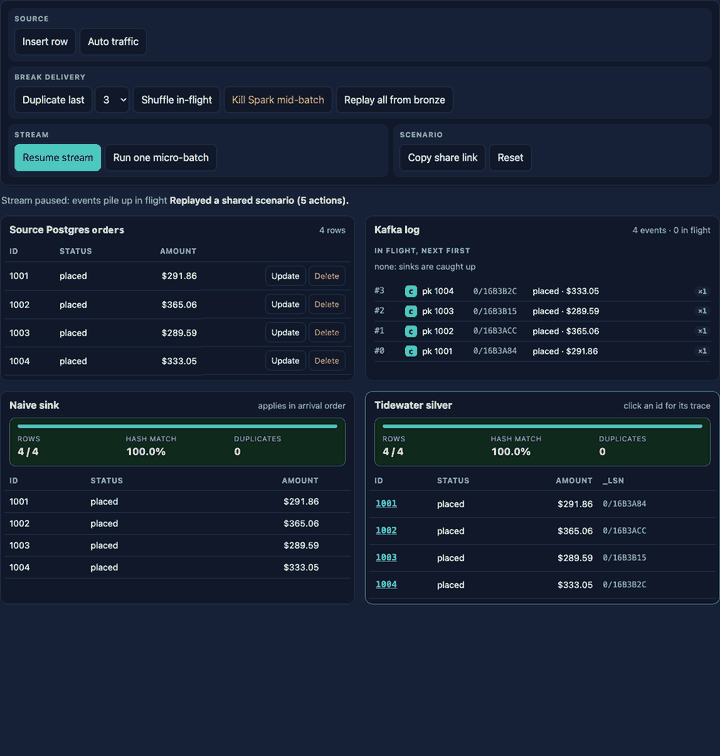
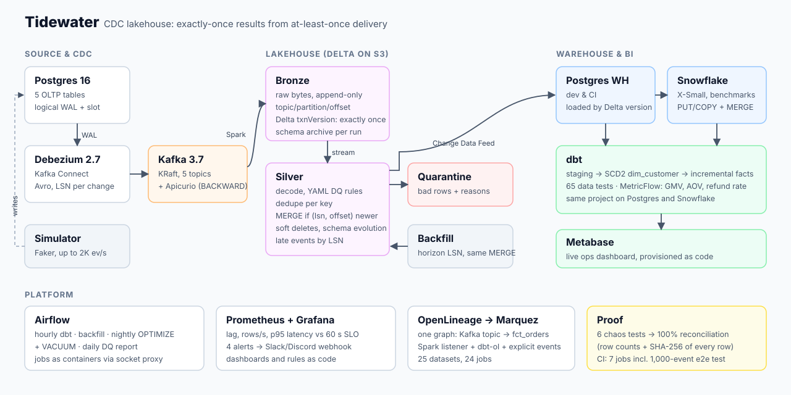
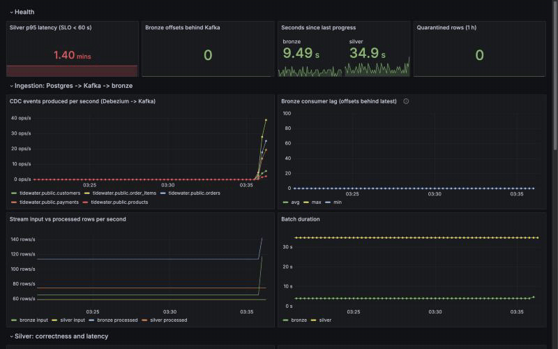

# Tidewater

[](https://github.com/Gnanasudharsan/tidewater/actions/workflows/ci.yml)
[](https://github.com/Gnanasudharsan/tidewater/actions/workflows/showcase.yml)
[](https://codespaces.new/Gnanasudharsan/tidewater?quickstart=1)
[](https://gnanasudharsan.github.io/tidewater/catalog/)


**A CDC lakehouse that turns at-least-once Kafka delivery into exactly-once results, and proves it by crashing itself.**

Postgres → Debezium → Kafka → Spark → Delta Lake → Postgres / Snowflake → dbt → Metabase, with
Airflow, Prometheus/Grafana, OpenLineage and Terraform. Runs on a laptop for $0; benchmarked on Snowflake.

**[Live site: try to break it in your browser →](https://gnanasudharsan.github.io/tidewater/)**
Redeliver, shuffle, kill Spark mid-batch and replay events against a naive sink and
Tidewater's merge, then check the latest verified run of the real pipeline in CI.

[](https://gnanasudharsan.github.io/tidewater/#try)



## Results (measured, not projected)

| | Result | Evidence |
|---|---|---|
| **Correctness under failure** | **0 duplicates, 0 gaps, 100% reconciliation** after every one of 6 chaos tests (SIGKILL mid-batch, Debezium outage, live DDL, malformed events, silver rebuilt from bronze, concurrent backfill) | [chaos suite](#chaos-suite) |
| **Reconciliation** | row counts + SHA-256 of every column of every row, silver vs. source: 100% on 4.5M rows | [`reconcile.py`](spark/jobs/reconcile.py) |
| **Source throughput** | **2,000 business events/s** (5,232 CDC records/s) with 0 Kafka lag | [bench](bench/README.md) |
| **Latency SLO** (p95 < 60 s) | **met at 100 ev/s on small tables (59.7 s); missed at scale (92–122 s at ~250k rows/table)**: silver MERGE cost grows with table size | [bench](bench/README.md#3-what-to-tune-next-the-evidence-points-here) |
| **Same dbt project, two warehouses** | 81/81 on Snowflake, 80/80 on Postgres. Full rebuild over identical data: **16.3 s** Postgres vs **31.7 s** Snowflake (level on heavy models; Snowflake pays per-query overhead) | [comparison](bench/README.md#4-postgres-vs-snowflake-same-dbt-project-same-data) |
| **Cost** | **~0.059 Snowflake credits per million rows** delivered and transformed (X-Small, all-in) | [cost](bench/README.md#5-snowflake-cost) |
| **A real incident** | Kafka lost every topic; the pipeline refused to continue, was recovered to 100%, and got a postmortem | [postmortem](docs/incidents/2026-11-01-kafka-log-loss.md) |



## How the showcase works

The [live site](https://gnanasudharsan.github.io/tidewater/) has two kinds of evidence,
labelled as such:

- **The simulator is a simulation.** It runs in the browser with
  [`site/js/merge.js`](site/js/merge.js), a port of the silver MERGE rule. A parity test
  ([`tests/parity`](tests/parity)) runs the same tricky event sequences (duplicates,
  out-of-order events, a delete followed by a late update, a kill mid-batch, a full
  replay) through `merge.js` and through the real PySpark merge on Delta Lake. CI fails
  if their final state or their late events differ.
- **The proof is real.** [`showcase.yml`](.github/workflows/showcase.yml) runs on every
  push to `main`, nightly, and on demand. It starts the real stack, pushes 1,000 events
  through to the dbt marts, runs chaos tests 01 and 04, and reconciles silver against
  the source row by row. [`emit_results.py`](scripts/emit_results.py) writes what was
  measured to `latest.json`, and the site shows it with a link to the run. A failed run
  is published as failed. Anything not measured shows "Not yet measured", never a
  placeholder. The last 30 runs are kept on the `showcase-data` branch.

The results tables come from committed files (`bench/results/`,
[`results/chaos_local_runs.json`](results/chaos_local_runs.json)). The dbt docs are
published at [`/catalog/`](https://gnanasudharsan.github.io/tidewater/catalog/).
`make site` previews it all locally.

**Codespaces:** the core profile's container memory limits add up to about 9.6 GB
(about 6 GB in practice), and `make demo` adds Prometheus and Grafana. That fits the
4-core / 16 GB machine the devcontainer asks for. Running every profile at once (about
19 GB of limits) needs a bigger machine.

<details>
<summary>One-time setup for the repo owner</summary>

1. **Settings → Pages → Build and deployment → Source: GitHub Actions.**
2. **Settings → Actions → General:** allow GitHub Actions to run. The workflow declares
   its own token permissions (`contents: write` only for the job that updates the
   `showcase-data` branch; `pages: write` and `id-token: write` only for the deploy job),
   so the default read-only token setting is fine.
3. **Settings → Environments → github-pages:** keep the default rule that allows
   deployments from `main`.
4. Run it once: **Actions → showcase → Run workflow**.

**The nightly run stops after 60 days without repository activity.** GitHub disables
scheduled workflows in inactive public repos and emails the owner. To turn it back on:
**Actions → showcase → Enable workflow** (or push any commit). The site's badge turns
⚠️ stale once the latest run is more than 48 hours old.

</details>

## Quickstart

Docker with ~6 GB of RAM (16 GB to run every profile at once).

```bash
git clone https://github.com/Gnanasudharsan/tidewater.git && cd tidewater
make up-core     # Postgres, Kafka, Debezium, schema registry, S3, bronze + silver streams
make demo        # 5 min: live load, SIGKILL mid-batch, recovery, then proof
```

`make demo` ends by checking bronze (every Kafka offset exactly once), reconciling
silver against the source, and tracing one order back to its WAL LSN. Grafana is at
http://localhost:3001. `make help` lists everything else.

## How exactly-once is achieved

At-least-once delivery means every change can arrive twice, late, or out of order.
Tidewater makes every write **idempotent and order-insensitive**:

1. **Bronze** appends raw Kafka records with Delta's `txnAppId` + `txnVersion = batch id`.
   A batch replayed after a crash is skipped by Delta itself.
2. **Silver** applies a change only if its `(WAL LSN, Kafka offset)` is newer than the
   stored row. Replays are no-ops, stale events are rejected (and recorded as late),
   deletes are soft, so a late update can't resurrect a row.
3. **Backfills** read the source after a *transaction horizon* and stamp rows with that
   LSN, so they can run concurrently with the stream without overwriting newer data.
4. **The warehouse** loads by Delta version (Change Data Feed), not by timestamp, with
   the upsert and bookmark in one transaction.

| Guarantee | Proof |
|---|---|
| Bronze has every offset exactly once | [chaos 01](tests/chaos/01_kill_bronze_mid_batch.sh) crashes mid-batch *and* right after the Delta commit; [`verify_bronze.py`](spark/jobs/verify_bronze.py) checks every partition |
| Newest version wins, replays change nothing | [merge tests](spark/tests/test_silver_merge.py): dedup, out-of-order, replay twice, ties, deletes, new columns |
| Concurrent backfill is safe | [chaos 06](tests/chaos/06_concurrent_backfill.sh): 341k-row backfill during live CDC, 100% reconciled |
| Bad data never reaches silver silently | YAML [contracts](spark/conf/silver_tables.yml) → quarantine with reasons; [chaos 04](tests/chaos/04_malformed_events.sh) |
| Replays never depend on the schema registry | [schema archive](docs/adr/0010-schema-archive-in-bronze.md): [chaos 05](tests/chaos/05_rebuild_silver_from_bronze.sh) rebuilt silver from pre- and post-incident bronze |
| End to end in CI | 7 jobs on every push, including a Compose integration test that pushes 1,000 events and asserts the marts to the cent |

## Chaos suite

| # | Failure injected under live load | Result | What it found |
|---|---|---|---|
| [01](tests/chaos/01_kill_bronze_mid_batch.sh) | SIGKILL bronze mid-batch ×3 + crash after Delta commit | PASS | replay skipped by `txnVersion` |
| [02](tests/chaos/02_debezium_outage.sh) | Debezium down (ran 180 s; default 600 s) | PASS | replication slot retained the WAL |
| [03](tests/chaos/03_add_column_live.sh) | `ADD COLUMN ... DEFAULT` live | PASS | **metadata-only DDL emits no CDC for existing rows**: the procedure is ALTER + backfill |
| [04](tests/chaos/04_malformed_events.sh) | malformed Kafka records + a DQ-violating row | PASS | each quarantined with its exact reason |
| [05](tests/chaos/05_rebuild_silver_from_bronze.sh) | drop all silver, rebuild from bronze | PASS | needed a schema archive and a delete-repair backfill |
| [06](tests/chaos/06_concurrent_backfill.sh) | full backfill during live CDC | PASS | **unpartitioned MERGE targets conflict on every commit**; fixed with retry budget + pacing |

Every scenario has a [runbook](docs/runbooks/).

## What went wrong (and what it taught)

The [dev log](docs/devlog.md) records every bug; the best ones:

- **Kafka lost every topic** when its container was recreated: `KAFKA_LOG_DIRS` was
  unset, so the volume was never used. Bronze refused to skip offsets, Debezium
  re-snapshotted from the replication slot, a delete-detecting backfill repaired the
  gap, and reconciliation proved 100%. [Postmortem](docs/incidents/2026-11-01-kafka-log-loss.md).
- **Registry IDs are not stable identifiers**: after that rebuild, schema ID 9 meant
  `orders` before and `order_items` after. Bronze now archives its own schemas.
- **A filter is not a guard in Spark**: `from_avro` ran on another table's bytes
  because Spark reordered filters, and exhausted the heap. Fixed with `CASE WHEN`.
- **The benchmark lied before the pipeline did**: racing simulators and a "silver is
  quiet" heuristic produced plausible but wrong numbers until the harness was fixed.
- **An optimization that didn't work**, reported as such: concurrent per-table MERGEs
  were inconclusive in an A/B/A test, so they ship behind a flag, off.

## Trade-offs and future work

- **Silver latency grows with table size.** Every MERGE into an unpartitioned table
  rewrites large files, and concurrent writers conflict on every commit. Next:
  Delta deletion vectors, then key-range partitioning (same A/B/A method).
- **Backfill corrections live in silver, not bronze**, so a rebuild from bronze needs a
  delete-repair backfill afterwards. Recording backfills as bronze events would fix it.
- Single node, no HA; benchmarks ran on a shared laptop (see the caveats in [bench](bench/README.md)).
- Out of scope until the core guarantees were proven: Flink, Iceberg, Kubernetes ([non-goals](docs/design.md#5-non-goals)).

## Docs

- [Design doc](docs/design.md) (problem, SLOs, non-goals) · [Benchmarks](bench/README.md) · [Snowflake setup](docs/snowflake.md)
- ADRs: [Delta vs Iceberg](docs/adr/0001-delta-lake-over-iceberg.md) · [Soft deletes](docs/adr/0002-soft-deletes.md) ·
  [LSN ordering](docs/adr/0003-lsn-based-ordering.md) · [Medallion](docs/adr/0004-medallion-layering.md) ·
  [Postgres dev / Snowflake bench](docs/adr/0005-postgres-dev-snowflake-bench.md) · [SeaweedFS](docs/adr/0006-seaweedfs-over-minio.md) ·
  [Late data by LSN](docs/adr/0007-late-data-by-lsn-not-watermark.md) · [Load by Delta version](docs/adr/0008-warehouse-load-by-delta-version.md) ·
  [Socket proxy](docs/adr/0009-orchestrate-containers-via-socket-proxy.md) · [Schema archive](docs/adr/0010-schema-archive-in-bronze.md)
- [Runbooks](docs/runbooks/) · [Dev log](docs/devlog.md) · [Audit trace notebook](notebooks/audit_trace.ipynb) · [dbt docs + lineage](https://gnanasudharsan.github.io/tidewater/)

<details>
<summary><b>All commands, services and profiles</b></summary>

```bash
make up-core / up-wh / up-obs / up-orch / up-lineage   # compose profiles
make sim RATE=50                  # live traffic
make verify-bronze reconcile      # the two proofs
make chaos N=03                   # any chaos test
make backfill ARGS="--table orders --detect-deletes"
make load-wh dbt-build metrics dashboard
make bench                        # throughput / latency sweep
make sf-plan sf-apply load-sf dbt-sf   # Snowflake
make integration test test-spark test-airflow lint
```

| Service | URL |
|---|---|
| Grafana / Prometheus | http://localhost:3001 / http://localhost:9090 |
| Metabase | http://localhost:3000 |
| Airflow | http://localhost:8085 |
| Marquez (lineage) | http://localhost:3002 |
| Kafka UI | http://localhost:8080 |
| Spark UI (bronze / silver) | http://localhost:4040 / http://localhost:4041 |
| Source / warehouse Postgres | `localhost:5432` / `localhost:5434` |

| Airflow DAG | Schedule | What it does |
|---|---|---|
| `dbt_build_hourly` | hourly | warehouse load, source freshness, `dbt build` |
| `backfill_range` | on demand | validated-window backfill, reload, rebuild |
| `lakehouse_maintenance_nightly` | 03:00 | OPTIMIZE + VACUUM (bronze: 2,110 → 15 files) |
| `dq_daily_report` | 06:00 | per-table DQ summary; fails above a threshold |

</details>

## License

[MIT](LICENSE)
